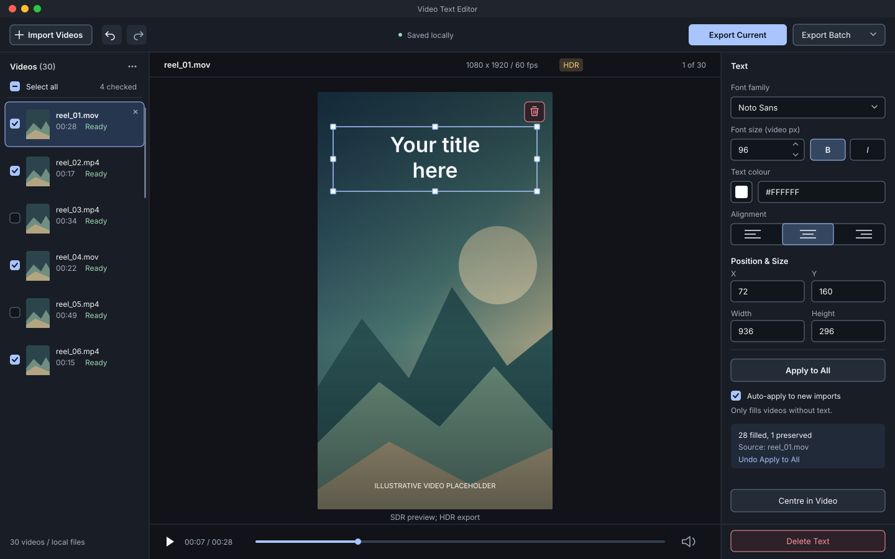

# Video Text Editor: macOS-First Design

- Version: 0.9
- Date: 2026-11-17
- Status: APPROVED; Milestone 9 local-only Mac review implemented; physical HDR review pending
- Requirements: [approved PRD](./PRD.md)
- Scope: full-product design; implementation proceeds only through authorized milestones
- Current step: Milestone 10 authorized for Windows 10/11 x64 CPU-compatible preview; client-OS/hardware certification pending

## 1. Decisions in plain language

The application has three main parts:

1. **The window:** video list, preview, text controls, and export dialogs.
2. **The editing rules:** text placement, resizing, Apply to All, and saving work.
3. **The video engine:** reads originals and produces the final edited files.

We will share the window and editing rules across macOS and Windows. The video
workflow will also be shared where supported; bundled executable files, hardware
encoding, permissions, and packaging still need platform-specific handling.

| Decision                                                 | Status                                                                                    |
| -------------------------------------------------------- | ----------------------------------------------------------------------------------------- |
| Shared codebase rather than separate Mac/Windows editors | Confirmed                                                                                 |
| macOS 15+ / Apple silicon; Windows 10/11 / Intel x64 preview | Confirmed; Windows preview authorized on 2026-11-18                                      |
| Dark three-column editor and speed-first preview         | Confirmed                                                                                 |
| Electron + React + TypeScript                            | Implemented; packaged foundation and native SDR/HDR tests pass                            |
| Chromium textarea plus custom selection frame            | Adopted after the Milestone 2 interaction/fidelity proof; no Fabric dependency            |
| Bundled FFmpeg/ffprobe for local media work              | LGPL-only Mac tools; separate GPL CPU Windows tools; physical HDR review pending          |

Design approval alone is not validation. SDR/HDR numerical checks and a real HLG
export are recorded below and in the implementation plan. Physical HDR visual
review, reference-hardware performance and minimum-OS execution remain unverified.

## 2. Why this shared foundation

| Option   | Strength                                                     | Trade-off for this product                                                                           |
| -------- | ------------------------------------------------------------ | ---------------------------------------------------------------------------------------------------- |
| Electron | Bundles Chromium; shares desktop UI code across platforms    | Larger application/runtime footprint; must keep the bundled runtime maintained                       |
| Tauri    | Uses operating-system webviews rather than bundling Chromium | macOS uses WebKit and Windows uses WebView2; text/media behavior needs more cross-engine validation  |
| Flutter  | Supports compiled macOS and Windows desktop applications     | Also viable, but would introduce Dart and require validation of the chosen desktop media integration |

**Recommendation: Electron, React, and TypeScript.** One bundled browser engine
reduces the number of different text/canvas environments we must support. Native
video work stays outside the UI process rather than being implemented as slow
JavaScript video encoding.

This is a product-specific trade-off, not a claim that Electron is always faster
or smaller. It also does not guarantee identical glyph rasterization across OSes:
the font/layout/export tests are still required.

Use ordinary CSS and a small set of reusable controls. Do not introduce a large
design system, backend server, account system, or multi-package monorepo.

## 3. Visual design



[Open the full-size mockup](./editor-macos.svg).

This is a static vector mockup, not a running editor. The video illustration,
filenames, text, and progress/count values are examples, not real imported media
or evidence of rendering fidelity.

### Layout

- Native macOS title bar, with the application toolbar below it.
- Toolbar: Import, Undo/Redo, local-save status, Export Current, Export Batch.
- Left: fixed 240-pixel video sidebar, independent export checkboxes, active-row
  highlight, filenames, thumbnails, durations, and statuses.
- Centre: flexible preview with metadata above and playback controls below.
- Right: fixed 280-pixel inspector; scroll its contents when vertical space is short.
- Minimum window 1100 x 700; initial size up to 1440 x 900 within the desktop.
- The entire video fits the preview. No preview zoom or user-resizable columns.

The PRD's UI inventory remains the source of truth for all components and dialogs.

### Inspector order

1. Font family.
2. Font size, Bold, and Italic.
3. Colour swatch and HEX.
4. Left/centre/right alignment.
5. Position & Size: X/Y, then Width/Height.
6. Apply to All, with the helper "Only fills videos without text."
7. Auto-apply to New Imports checkbox and last-applied-default explanation.
8. Copy results, mixed-ratio review note, errors, and immediate Undo when available.
9. Centre in Video.
10. Delete Text, in a persistent bottom action area.

The batch section is visually separated from the controls that affect only the
active video. A visible explanation must prevent the impression that subsequent
per-video changes are live-linked.

### Visual tokens

All values below describe editor chrome, not exported video text.

| Token                   | Value / use                                                            |
| ----------------------- | ---------------------------------------------------------------------- |
| Window                  | `#111318`                                                              |
| Panel                   | `#191D25`                                                              |
| Input background        | `#11151C`                                                              |
| Primary text            | `#F5F7FA`                                                              |
| Secondary text          | `#A8B1BF`                                                              |
| Accent / focus          | `#A8C5FF`                                                              |
| Text on accent          | `#10131A`                                                              |
| Essential input outline | `#66758A`                                                              |
| Danger text             | `#FF929A`                                                              |
| Spacing                 | 4-pixel base; normally 8, 12, 16, and 24 pixels                        |
| Controls                | 32-pixel minimum hit area; 36-pixel primary action height              |
| UI typography           | System UI font; 13-pixel body/control text, 12-pixel secondary text    |
| Video typography        | Bundled Noto Sans/Noto Serif plus the validated bundled emoji fallback |

Calculated contrast checks: primary text/panel 15.73:1; secondary text/panel 7.80:1;
primary-button text/accent 10.70:1; input outline/input 3.90:1; focus/panel 9.72:1;
danger text/panel 7.90:1. These pass the relevant 4.5:1 text and 3:1 component
thresholds. Actual rendered focus, disabled, hover, and error states still need UI
validation during implementation.

## 4. Editor interaction design

| State / action                        | Behavior                                                              |
| ------------------------------------- | --------------------------------------------------------------------- |
| No text box; click video              | Pause, create box, enter typing                                       |
| Existing box; click anywhere on video | Select existing box, without moving or copying it                     |
| Double-click box                      | Edit text directly                                                    |
| Drag selected box                     | Move the whole box                                                    |
| Drag any handle                       | Resize the box bounds; never change font size                         |
| Narrow box / add content              | Reflow and grow minimum height as required                            |
| Hover box                             | Reveal delete action outside its top-right corner                     |
| Click inspector                       | Retain active box and apply changes to its whole text                 |
| Switch video                          | Show that video's saved copy, paused at its stored playhead           |
| Export running                        | Lock editing and batch/default changes; keep Cancel Export accessible |

Text cursor selection and arrow keys retain normal text-entry behavior while
typing. Object nudging and object deletion apply only outside text-entry controls.
Clicking outside the video in unused workspace space ends editing/deselects.

### Text canvas

Use the shared `TextLayer`: a plain Chromium textarea with a separate custom
selection frame. The originally proposed Fabric adapter is not used. Native
text entry supplies caret/selection, IME handling, plain-text paste and wrapping
without overrides to a third-party object's height/scaling behavior.

- Use the same textarea styling and bundled fonts in preview and export.
- Keep canonical source-pixel bounds and font size independent of preview scale.
- Eight custom controls call pure resize rules with injected DOM fit measurement.
- Measure minimum width by grapheme and wrapped minimum height through Chromium.
  Preserve extra blank height; never shrink the font.
- Keep the box and measured minimum height together in the editing hook. Measure
  during mutations rather than introducing state updates during React rendering.
- Reject invalid numeric height without mutating geometry; handle drags clamp
  against minimum fit while preserving the opposite anchor.
- Apply one whole-box style. Text-entry keys do not trigger object deletion/nudging.
- Warn about unverified character repertoires; this is not complete font-cmap or
  shaping certification.

The native proof covers multiline/long-word reflow, every handle, representative
emoji/combining-character caret movement and real overlay/export geometry.
Complete history and single-video UX now pass the Milestone 5 checks. Multiple
videos and persistence are implemented in Milestone 6; text reuse and defaults
are implemented in Milestone 7. Sequential batch export is implemented in Milestone 8.

### Persistent collection implementation (Milestone 6)

- The pure shared collection reducer owns row order, active ID, checks, playheads
  and independent text histories. Retention is globally bounded to 100 steps /
  16 MiB estimated storage, evicting inactive history without deleting current text.
- Main-process `WorkspaceService` owns private source references and restoration;
  `WorkspaceStore` owns schema-checked, serialized, atomic/fsynced writes and backup
  recovery. The renderer never chooses the persistence file or supplies source paths
  outside native file selection. Unknown versions/corrupt data block overwriting.
- `MediaService` owns a source-ID map and poster protocol; each native export or
  preview still selects exactly one validated source. A bounded streaming SHA-256
  runs alongside probing. Relink verifies full contents before changing the entry.
- The editor debounces autosave by 200 ms and derives save status from the actual
  acknowledged document. Closing uses a validated flush handshake; active imports
  stop, pending React edits flush, and a failed save defaults to keeping work open.
- Remove/Clear reserve a synchronous renderer mutation gate, suspend autosave
  and conflicting edits, and publish their resulting React state before resolving
  their completion promise. Closing waits for that promise and pending import/
  relink work before taking its final snapshot. Token-validated native close
  acknowledgements cancel abandoned requests without leaving editing locked.
- Main publishes a document only after its save succeeds. Once removal is
  committed, cached-media cleanup failures are logged and returned as explicit
  warnings; logical source registration is still released. Clear continues
  cleanup across files. The renderer never treats a committed change as a failed
  mutation just because its disposable poster could not be removed.
- Workspace reload restores text/checks/order/time and last output directory,
  but never autoplays or restores Undo history. Source failures preserve geometry
  and offer Locate/Remove rather than silently discarding the entry.

### Selection, history and inspector

- Keep selection (`none`, object, or text entry) separate from the canonical box.
  Inspector interaction commits typing and retains the object; unused workspace
  space commits/deselects. Add Text is the accessible centred-creation alternative.
- A pure shared reducer stores complete box/minimum-height snapshots. Gesture,
  inspector and composition groups commit together; typing bursts split after
  750ms idle or an explicit caret/selection/commit boundary. No-op gestures retain
  redo; divergent edits clear it. Auto-fit belongs to the triggering edit.
- The active source's hook owns session-local history. Successful source
  replacement resets it and inspector drafts. Playback/seeking/export are not edits.
  The approved limit is 100 steps or 16 MiB of estimated snapshot storage
  across Undo/Redo/pending edits. Eviction never changes the current text.
- The native Edit menu receives validated availability/field-focus state and
  sends only allowlisted Undo/Redo commands through preload. Video text uses
  canonical history; ordinary numeric/HEX inputs keep native field undo.
  Queued focus updates cannot overwrite a newer menu-state subscription.
- Use an in-inspector, swatch-anchored opaque colour panel: saturation/value
  surface, keyboard-accessible HSV sliders and presets. It never opens a native
  colour dialog during hidden automation. Reject unsupported/alpha HEX rather
  than truncating it. Emoji retain intrinsic colours.
- Manually entered font size accepts one decimal place, with explicit
  one-video-pixel steppers. Copied fractional values retain their full canonical
  precision; merely focusing/blurring a rounded display does not validate or
  overwrite it, and steppers preserve the fractional remainder.
  Numeric errors expose inline descriptions and retain valid canonical geometry;
  renderer font-size limits fail explicitly instead of silently clamping.
- Hover/focus/selection exposes deletion outside the box with an interactive
  pointer bridge; persistent inspector deletion remains available. Fit changes
  never mutate box geometry. All eight resize handles undo in one step.

## 5. Geometry and shared text rendering

Store text in oriented video pixels, not screen pixels or percentages rounded for
display. Use one canonical text model for preview, inspector, copying, and export.

```text
fitScale = min(availablePreviewWidth / videoWidth,
               availablePreviewHeight / videoHeight)

screenPoint = videoOriginInPreview + videoPoint * fitScale
videoPoint  = (screenPoint - videoOriginInPreview) / fitScale
```

The video origin includes aspect-fit gutters. Only clicks inside the video's
rectangle trigger video-background creation/selection.

- Lay out text in source coordinates before applying the preview transform.
- Clip video text to the video rectangle, but allow selection controls in its gutter.
- Use the same bundled fonts, text adapter, wrapping, padding, and layout data to
  rasterize the export overlay at source resolution.
- Never re-create text independently with FFmpeg `drawtext`: a second text-layout
  engine would risk different wrapping, font fallback, and emoji.
- Exclude caret, selection handles, placeholder, and editor controls from the overlay.
- Produce at most the active preview and current export overlay at a time; do not
  cache 30 full-resolution RGBA overlays.
- Wait for bundled fonts to load before measuring or exporting.

The export artifact is a full-frame transparent RGBA PNG at oriented source
resolution. A separate hidden, sandboxed BrowserWindow loads the same text layer
and fonts. Main authenticates its private request/ready handshake and waits for
layout; CDP fixes source dimensions and device scale factor one before capture.

Chromium screenshots can contain ICC-tagged Display P3 pixels. FFmpeg does not
apply that PNG profile, so passing the screenshot through unchanged visibly
changes text colour. The hidden page decodes the captured PNG and draws it
one-to-one into an explicitly sRGB canvas before serialization. Main invokes
only that fixed DOM conversion with JSON-escaped image data; it exposes no
generic execution capability to either renderer. No text is re-laid out or
rescaled. Main validates the resulting source dimensions.

The coloured-serif proof improved from RGB error 11.37/255 to 3/255 (limit 5),
with matching oriented corners and source-pixel bounds. Test screenshots retain
ICC data: resizing a screenshot through Playwright can strip it and invalidate
colour comparisons. This SDR proof does not solve HDR compositing.

## 6. Application structure

```text
React editor window
  - UI and interaction state
  - authoritative editable workspace model
  - pure text/copy/history rules
  - shared text adapter and overlay rasterization
                |
       narrow, validated desktop API
                |
Electron main process
  - native dialogs and application lifecycle
  - source identity/access and media probing
  - autosave and recoverable workspace storage
  - preview/export process ownership and job status
                |
Bundled ffprobe / FFmpeg workers
  - metadata, thumbnails, low-quality preview
  - full-quality compositing/encoding
```

- Start with one React reducer/store for editing state, not several independent
  copies of the workspace or a general event-sourcing framework.
- Share TypeScript domain types and pure rules; validate serialized input at
  process/disk boundaries, not only at compile time.
- Main owns filesystem paths and native jobs. Renderer uses registered asset IDs
  and domain commands, not arbitrary filesystem or shell access.
- Use context isolation, renderer sandboxing, no renderer Node integration, a
  restrictive content policy, and no remote page loading.
- Spawn bundled tools with argument arrays, never interpolated shell commands.
- Long-running native processes must not block either application's event loop.
- The renderer owns current editable content; main acknowledges durable saves by
  revision and owns job/process status. An unacknowledged write is not "Saved."

### Principal data

| Record                | Purpose                                                                                                           |
| --------------------- | ----------------------------------------------------------------------------------------------------------------- |
| Media asset           | Stable ID, source identity/reference, oriented dimensions, stream/timing/colour metadata, thumbnail, availability |
| Text box              | Content, family/style/colour/alignment, font size, X/Y/width/height/padding                                       |
| Video workspace entry | Asset ID, independent text box, edit revision, playback position, last export result                              |
| Text default          | Detached text snapshot, reference dimensions, display label, auto-apply setting                                   |
| Workspace             | Schema version, collection/order, active ID, export checks, text default, output-folder preference                |
| Export job            | Frozen source identity and text revision, output format/destination, owned temporary paths, status/progress/error |
| History               | Per-video edits plus an immediate Apply to All group checkpoint; not persisted across launches                    |

Preserve rational timing information for media work rather than treating a rounded
display frame rate as the source timeline.

## 7. Apply to All design

Use the PRD's relative-copy formulas as pure, independently testable rules.

1. Commit active typing and capture a detached snapshot.
2. Identify other entries with absent/empty/whitespace-only text.
3. Compute independent target boxes using oriented dimensions.
4. Keep non-empty existing text untouched, including earlier copies.
5. Reflow/grow minimum height; retain negative/off-frame positioning.
6. Update the saved new-import default and counts without changing export checkboxes.
7. Record successful copies and default/settings as one immediate group operation.

Navigation/playback do not consume group Undo. The next content/default mutation
or import/removal ends that group opportunity; per-video histories remain usable.
Immediate group Undo restores affected entries and the previous default/settings.

New imports inherit the last-applied snapshot only when enabled. Merely reopening
an existing video or restarting the app must never refill deliberately deleted text.

### Implemented Milestone 7 boundaries

- Shared pure copy rules take an injected DOM measurement function. Target
  fitting errors are reported individually; successful targets and the detached
  default are applied together without changing source text or export checks.
- The collection reducer retains target before/after histories and previous/new
  defaults for immediate group Undo/Redo. It restores only those fields, never
  navigation, playheads, checkbox changes, source edits or source metadata.
  No-op commits do not consume the group opportunity.
- Live and group-held history share the 100-step / 16-MiB estimated budget.
  Older inactive histories are evicted first. If the checkpoint itself cannot
  fit, current text/default remain and the inspector explicitly reports loss of
  immediate group Undo.
- Async imports read the latest enabled/default snapshot after native import
  completes, not a stale renderer capture. Failure to fit inherited text keeps
  the video without text and reports the error.
- Workspace version 2 persists the detached snapshot and enabled state, even
  after source-row removal. Version 1 migrates with no default; Clear Workspace
  resets it. Group history and copy-result reports remain session-local.
- The inspector section sits after Position & Size and before Centre in Video.
  It is outside disabled per-video styling controls, so an existing default can
  be toggled with no active text/source. Export locks both copy/default changes.
- Review detection compares both display and coded-pixel aspect ratios.
  Different pixel shapes can change wrapping even at the same display ratio.
  This adds a review warning; it does not change the approved copy formulas.
  Clear Workspace stays available for a detached default without any video rows.

## 8. Fast preview design

Keep preview and final encoding separate.

- Probe source metadata asynchronously and show a small oriented poster frame first.
- The user can place text on that frame without waiting for a full proxy transcode.
- Implemented common playback path: an on-demand low-resolution SDR H.264/AAC stream
  produced by the media worker and played by Chromium.
- Fragmented-MP4/MediaSource delivery passes native playback, window-boundary,
  seek, HDR/rotation and cancellation tests. Opaque one-use local protocol URLs
  carry eight-second windows with stream backpressure, not complete proxies.
- Keep buffering/cache bounded around the active playhead; seeking cancels stale
  work and requests frames/streaming from the new position.
- Only the active video owns a preview decoder. Cache small posters/thumbnails,
  not 30 active players or complete decoded videos.
- SDR uses at most a 720-pixel long edge / 15 fps. HDR adapts to 360 pixels under
  the PRD's downward-adaptation allowance after the seek benchmark missed its
  target. HEVC yuv420p10le HDR without display-matrix metadata uses VideoToolbox
  scaling before CPU readback. A zero-degree matrix can still mirror a picture;
  all display transforms/other formats keep the established orientation-aware path.
  50 ms fragments reduce first-frame startup. Text retains canonical source-pixel
  layout; these adaptations never change export geometry/quality.
- Tone-map HDR for this placement preview and show "SDR preview; HDR export."
- Keep audio, playback time, and seeking aligned to the original timeline.
  Preview uses the first audio track converted to stereo AAC; export retains its
  existing all-track policy. Preview Mute changes only the HTML media element.

Native ownership is separate from the export coordinator. Superseding requests
wait for the old decoder to close; stream cancellation also closes its stdout
pipe so backpressure cannot deadlock cleanup. The renderer adapter owns
MediaSource/SourceBuffer, a small forward buffer and roughly two seconds of
retained history at refill. SourceBuffer timestamp offsets preserve the original
timeline. Starting a text operation pauses playback.

The retained 30-minute 4K60 Main10 HLG benchmark passes against the actual hardened
0.9.0 isolated app on the available M4 Max / 48 GiB / macOS 26.7.2 Mac: 1.374-second
import-to-editable and 972.0 ms p95 presented-frame seeking, with one decoder,
143.5 MiB peak decoder RSS and about 12 seconds peak buffering. Active native
export cancellation acknowledges in 17.6 ms and stops within 2.460 seconds.
Seek headroom is small; a development-runtime run measured 1021.5 ms.
It uses a looped synthetic pattern, not diverse real camera footage. M1 Pro
reference-hardware and minimum-macOS certification remain open; see the plan.
Automated windows now stay hidden and non-focusable, with macOS activation
prohibited in test mode and background rendering enabled. Confirmation responses
are controlled by the test harness rather than visible modal dialogs. Normal
application launches retain their ordinary window/focus behavior.

## 9. Export design and the HDR gate

1. Preflight scope, skip reasons, source access, and the output folder.
2. Freeze job definitions and save pending workspace edits.
3. Lock editing; rasterize one source-resolution text overlay per job.
4. Run the validated colour-aware compositor/encoder sequentially.
5. Preserve source timeline, orientation, dimensions, and audio.
6. Validate the output; publish it under a collision-safe final filename.
7. Continue after individual failures and show truthful results.

Eight-bit SDR output preserves H.264 or HEVC Main in MP4; supported 10-bit SDR
and HDR use Main10 HEVC. Source codec authority stays native, not renderer-selected.
Compatible AAC streams are copied; other supported audio is encoded as AAC.
HDR retains appropriate HLG/PQ signalling, not exact Dolby Vision metadata.
These are high-quality lossy exports, not a lossless guarantee.

The user approved source-aware encoding and selected balanced size/quality.
Average bitrate targets 1.5 times the source video bitrate, limited at 1.5 times
that target with a three-second target buffer. Eight-bit/ten-bit minimums are
256 Kbps / 4 Mbps. When stream bitrate is absent, measure only the selected
video's packet sizes and duration; log that measurement and reject unusable
results. Never substitute total container/audio bitrate or an unbounded quality
preset. Encoder rate limits are not a guarantee of byte-identical file sizes.
The ten-bit minimum protects newly introduced glyph detail on simple gradients.

The worker adapter launches the bundled project-owned C guardian with a parent
lifeline, without shell evaluation or Electron RunAsNode. The guardian reaps its
media child after parent death, escalating after two seconds, then removes only
recognized files in the exact owned session/export directories supplied at launch.
Normal cancellation still awaits worker exit. Repeated Quit remains blocked until
the single cleanup operation has actually completed. Closing during an active
export offers Continue Export / Cancel and Quit. Outside export, ordinary macOS
last-window close retains normal application lifetime.

### Implemented Milestone 8 queue boundary

- The native queue, not the renderer, freezes job text, selects source authority,
  allocates exact temporary paths and serializes the existing validated renderer.
  Start saves pending edits; the renderer locks all edit/default/check mutations.
- Current, checked and all scopes have explicit preflight. Empty/whitespace text
  is skipped; unavailable sources and per-file blockers remain distinct.
  Destination probes check writing, hard-link publication and free space;
  planned names reserve duplicates. Failed folder-preference saves roll back
  the reviewed native plan and remembered preference together.
  Final hard-link publication handles late collisions without overwriting.
- One native job failure does not stop later jobs. Retry Failed opens preflight
  from the failed IDs and current workspace edits, never successful jobs.
- A separate fsynced/atomic export record journals transitions, not every progress
  tick. Relaunch marks active/pending work interrupted without restarting. Exact
  tracked temporary paths remain available for inspection when crash cleanup
  cannot be established; unrelated files/directories are never scanned or removed.
- Cancellation waits for the current renderer and cleanup, then marks pending
  jobs cancelled. Published outputs survive cancellation and cleanup warnings.
  The overlay's cancellation/deadline race covers its entire rendering pipeline,
  including stalled screenshot/conversion calls, and always destroys its window.
  Continue Export leaves the queue running; confirmed quit waits for completion
  of cancellation before flushing/closing. A native closing gate prevents a
  pending Start request from racing past close.
- A centred native HTML dialog supplies modal focus containment, preflight,
  current/overall progress, job states, results, retry and output-folder reveal.
  Modal state also gates keyboard/native-menu history and preview shortcuts.
  Window reopening restores an existing preflight; folder-picker replies must
  still belong to the current window and preflight before changing its plan.
  Cleanup/interruption notices persist outside the dialog after Done, including
  across edits, without duplicating alerts while the dialog is open.

**Important:** FFmpeg's overlay filter defaults to 8-bit YUV 4:2:0. Selecting a
10-bit encoder afterward does not restore lost precision or prove correct HDR.
The exact HDR compositor/filter path is therefore an explicit early design gate.

That proof must establish high-precision colour processing, correct conversion
of the sRGB text image into the video working space, appropriate text reference
white, correct alpha blending, and valid output colour metadata. Do not copy
stale Dolby Vision dynamic metadata after compositing.

### Implemented Milestone 3 colour adapter

The [colour module](../src/main/media/colour.ts) owns poster and export filter
plans; the media service still owns jobs, paths, cancellation and publication.
The shared asset schema carries an explicit SDR/HLG/PQ classification. The
renderer does not select native filters or codecs.

- Supported HDR inputs have 10-bit pixels, BT.2020 primaries, a BT.2020
  non-constant-luminance matrix, explicit full/limited range and HLG/PQ transfer.
  Dolby Vision profile 8 is accepted only with its matching standalone
  HLG/HDR10-compatible base and no enhancement layer. Ambiguous/unsupported
  variants fail explicitly. APAC audio is reported as unsupported, not discarded.
- Chroma is expanded at 10 bits. Matrix/range conversion then uses swscale's
  reference C backend into planar float32 RGB. Automatic HDR-to-linear mapping
  is deliberately bypassed because it clipped highlights in numerical tests.
- Explicit BT.2100/ST 2084 functions produce display-linear BT.2020 RGB in
  cd/m². HLG uses the nominal 1000-nit, gamma-1.2 reference display, including
  its luminance-dependent OOTF and inverse.
- The existing canonical sRGB overlay is linearized, converted from Rec.709 to
  Rec.2020 primaries and mapped to 203 cd/m² graphics white. Straight alpha is
  normalized independently and `maskedmerge` composites all three float planes.
- After inverse transfer and the output matrix, 10-bit full-chroma samples are
  resampled/repacked to P010 for HEVC VideoToolbox Main10, `hvc1`, source-aware
  bitrate, original range and explicit BT.2020/HLG or PQ signalling. Filter timebase
  is retained for SDR as well as HDR. The SDR adapter explicitly selects
  8/10-bit compositing and H.264/HEVC Main/Main10 encoding, preserving colour signalling.
- Frame side data and inherited HDR export metadata are removed before fresh
  signalling is applied. The encoded `dovi_rpu` bitstream filter also strips
  Dolby data: clearing frame side data alone did not prevent RPU emission in
  the real test. Before publication, every output HDR frame is decoded/scanned
  for forbidden metadata, in addition to codec/profile/depth, colour/range,
  geometry, duration, frame-count and audio validation.
- The bounded poster and low-quality playback are tone-mapped with Mobius. The preview
  explicitly says **SDR preview; HDR export**; export never uses that poster.

The reference backend avoids the legacy scaler's measured 8-bit-to-float white
and alpha normalization error. Chroma resampling remains explicitly 10-bit
because that backend does not implement subsampled output. Dense-gradient,
reference-white, colour and alpha tests use the actual graph with implicit
format conversion disabled. No additional native dependency or binary rebuild
was required.

Reference conventions: [ITU-R BT.2100](https://www.itu.int/rec/R-REC-BT.2100/en)
and [ITU-R BT.2408-9](https://www.itu.int/dms_pub/itu-r/opb/rep/R-REP-BT.2408-9-2026-PDF-E.pdf).
These numerical/encoding checks do not replace visual HDR review.

If the proposed FFmpeg build cannot satisfy this gate, revisit the media backend
behind the same job boundary. A native platform adapter may be needed; it must
not require rewriting the shared editor. Do not silently drop HDR or downgrade it.

Cancellation must stop owned writers before editing resumes. Preserve completed
outputs, remove only tracked partial files, and surface cleanup failures.

## 10. Saving, packaging, and platform boundaries

- Store a versioned workspace document in the OS application-data directory.
- Use atomic/recoverable writes; acknowledge a revision only after successful storage.
- Persist text copies and the detached default, not source-media duplicates.
- Restore paused and preserve missing-source entries for explicit relinking.
- Never restore undo history or restart interrupted exports implicitly.
- Bundle the fonts, emoji resources, FFmpeg, and ffprobe needed for offline use.
- Record the exact media-binary build, supported codecs/filters, and redistribution
  obligations. Do not assume every downloadable FFmpeg binary has the same licence.
- First packaging target is an Apple-silicon `.app` for local testing. Signing,
  notarization, and wider distribution must be addressed before public release;
  no App Store submission or auto-update system is included in this design.
- Milestone 9 explicitly targets local-only review on the user's Mac.
  Versioned review packaging never overwrites existing review directories.
  Actual-artifact tests audit architecture, fuses, symlinks, resources and notices.
  The hardened app also edits/plays/exports/restores offline after relocation
  outside the checkout with no developer PATH.

| Shared across releases                         | Platform-specific / separately validated                    |
| ---------------------------------------------- | ----------------------------------------------------------- |
| UI layout, text rules, Apply to All, histories | macOS vs Windows window/menu/shortcut integration           |
| Workspace schema and copy calculations         | Application-data paths and file permissions                 |
| Fonts, emoji resources, text-rendering adapter | Hardware codec availability and media-tool builds           |
| Job definitions, queue rules, result states    | Apple-silicon vs Windows x64 binaries and installers        |
| Most preview/export orchestration              | Actual playback, encoding, packaging, and performance tests |

Do not claim Windows support from a successful Mac build. The Windows release
needs its own build environment, packaged binaries, and acceptance runs.

The approved Windows preview targets Windows 10/11 x64 with software x264/x265
encoding, including HEVC Main10. Its separate offline FFmpeg build is GPL with
corresponding source and notices, while Mac resources remain LGPL-only.
Windows uses a separate generated manifest, PE/x64 validation, planar 10-bit
output and a Job Object supervisor with an explicit cancellation pipe.
The shared preview compositor, text layout and output validation stay authoritative.
Native GitHub Actions checks cover Windows Server 2022/2025 packaged behavior;
client-OS, physical HDR and reference-performance release gates remain open.

## 11. Feasibility gates before substantial implementation

Current evidence is limited to the milestones explicitly authorized.

| Gate                          | Proof required                                                                                                                                                  |
| ----------------------------- | --------------------------------------------------------------------------------------------------------------------------------------------------------------- |
| G1: Text interaction/fidelity | Passed local synthetic proof: direct editing, eight box-only handles, manual extra height, wrapping, representative emoji, matching full-resolution overlay     |
| G2: Preview                   | Native SDR/HDR/rotation/audio playback and 30-minute 4K60 synthetic latency/buffer proof passed on available M4 Max; M1 Pro reference verification remains open |
| G3: SDR export                | Passed local synthetic proof: actual MP4/MOV export, rotation, VFR, two audio streams, clipping, colour and geometry; independent AVFoundation playback         |
| G4: HDR export                | Automated float/10-bit HLG/PQ, text-white/blending, signalling and real HLG export checks passed; physical HDR visual review still pending                      |
| G5: Offline package           | Relocated hardened offline edit/play/export/restore and actual-artifact audit pass locally; minimum/reference hardware, physical HDR and wider-distribution certification remain open |

Do these small proofs before polishing the entire interface. If a gate fails,
record the result and revise the design rather than building around an unverified shortcut.

## 12. Sources checked

- [Electron introduction](https://www.electronjs.org/docs/latest/): bundled Chromium/Node and shared desktop code.
- [Electron process model](https://www.electronjs.org/docs/latest/tutorial/process-model): main/renderer responsibilities.
- [Electron security guidance](https://www.electronjs.org/docs/latest/tutorial/security): isolation, sandboxing, IPC and local-content precautions.
- [Tauri webview versions](https://v2.tauri.app/reference/webview-versions/): WebKit on macOS and WebView2 on Windows.
- [Flutter desktop support](https://docs.flutter.dev/platform-integration/desktop): macOS/Windows desktop and plugin support.
- [Fabric Textbox source](https://github.com/fabricjs/fabric.js/blob/HEAD/packages/core/src/shapes/Textbox.ts): automatic wrapping/height and default vertical-scaling restriction.
- [FFmpeg filter documentation source](https://github.com/FFmpeg/FFmpeg/blob/master/doc/filters.texi): overlay formats, default 8-bit output, alpha, and timing considerations.
- [FFmpeg licence information](https://ffmpeg.org/legal.html): licensing varies with enabled components/build.

## 13. Review gate

The user approved the visual and shared technology direction on 2026-11-17.
The [implementation plan](./IMPLEMENTATION_PLAN.md) and full PRD are now approved.
The user explicitly authorized Milestones 1 through 10, choosing local-only Mac
review for Milestone 9 and CPU-compatible Windows 10/11 x64 preview work for
Milestone 10. Broader release certification remains gated.
The desktop foundation and one-video SDR/HDR numerical proofs have passed local checks; see the
[implementation record](./IMPLEMENTATION_PLAN.md#8-current-checkpoint) and
[development guide](../README.md). Preview playback now passes local automated
checks; physical HDR review and reference-hardware certification remain open.
Native integration uses production bundles
in the development Electron runtime; separate hardened-package checks cover
artifact integrity, offline relocated editing/playback/export and result restore,
collection/relink/default inheritance and the opt-in long-video/cancellation
benchmark. Neither path certifies untested hardware or physical HDR appearance.
